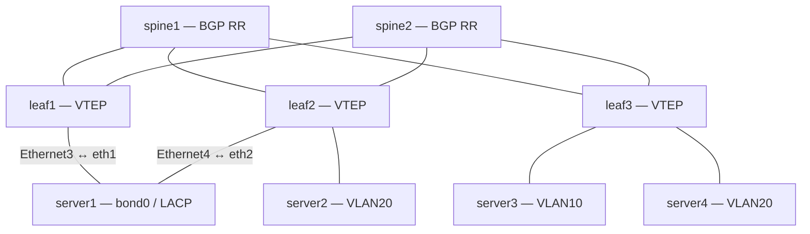

# HW7 — EVPN Multihoming (ESI-LAG) на Arista cEOS

## Цель работы

Подключить Linux-клиент двумя физическими линками к разным Leaf-коммутаторам, организовать LACP 802.3ad на клиенте и Ethernet Segment с режимом **all-active** в VXLAN EVPN Fabric. Проверить связность при работе обоих линков и при отключении каждого из них по отдельности.

## Лабораторная среда

| Компонент | Реализация |
|---|---|
| Хост | Windows / WSL2 / Ubuntu |
| Оркестрация | Containerlab 0.79.0 |
| Сетевые узлы | Arista cEOS 4.33.2F: 2 Spine, 3 Leaf |
| Клиенты | 4 Linux-контейнера `alpine:latest` |
| Underlay | OSPF, point-to-point-соединения |
| Overlay | MP-BGP EVPN, ASN 65100, RR на Spine |
| Data Plane | VXLAN, L2VNI и L3VNI |

> **Примечание.** Управляющая Docker-сеть `172.20.20.0/24` не используется для оценки передачи пользовательского трафика через EVPN. Тесты выполнялись с `server1` через `bond0`.

## Топология



`server1` dual-homed к Leaf1 и Leaf2. Оба соединения входят в один логический агрегатор Linux `bond0`.

## Адресный план и логические сегменты

| Узел / интерфейс | Адрес / назначение |
|---|---|
| Leaf1 Loopback0 / Loopback1 | `10.0.101.0/32` / `10.1.101.0/32` |
| Leaf2 Loopback0 / Loopback1 | `10.0.102.0/32` / `10.1.102.0/32` |
| Leaf3 Loopback0 / Loopback1 | `10.0.103.0/32` / `10.1.103.0/32` |
| server1 `bond0` | `10.10.10.11/24`, VLAN10 |
| server2 `eth1` | `20.20.20.12/24`, VLAN20 |
| server3 `eth1` | `10.10.10.13/24`, VLAN10 |
| server4 `eth1` | `20.20.20.14/24`, VLAN20 |
| Anycast Gateway VLAN10 | `10.10.10.254/24` (Leaf1, Leaf2) |
| Anycast Gateway VLAN20 | `20.20.20.254/24` (существующая фабрика) |
| VLAN10 / L2VNI | `10 / 10010` |
| VLAN20 / L2VNI | `20 / 10020` |
| VRF / L3VNI | `TENANT_A / 50001` |

### Параметры Ethernet Segment

| Параметр | Значение |
|---|---|
| Ethernet Segment Identifier | `0000:0000:0000:0000:0010` |
| Интерфейс | `Port-Channel10` на Leaf1 и Leaf2 |
| LACP System ID | `1111.2222.0010` |
| Redundancy | `all-active` |
| Клиентский агрегатор | `bond0`, IEEE 802.3ad, LACP fast |
| Access VLAN | VLAN10 |

## План выполнения

1. Расширить топологию двумя подключениями `server1` к Leaf1 и Leaf2.
2. Настроить LACP `Port-Channel10` на обоих Leaf.
3. Настроить общий ESI и LACP System ID на обоих Leaf.
4. Настроить L2VNI10010 и BGP EVPN VLAN10 на Leaf2, обеспечить локальный Anycast Gateway VLAN10 на обоих Leaf.
5. Настроить Linux bonding `802.3ad` на `server1` и маршрут к VLAN20 через фабрику.
6. Проверить OSPF, MP-BGP EVPN, LACP, L2/L3-связность.
7. Проверить работу после отключения каждого клиентского линка.
8. Сохранить мастер-конфигурации и проверить автоматическое развёртывание.

## Основные настройки

### Containerlab: соединения

Фрагмент `fabric.clab.yml`:

```yaml
links:
  # ... соединения Spine–Leaf ...
  - endpoints: ["leaf1:eth3", "server1:eth1"]
  - endpoints: ["leaf2:eth4", "server1:eth2"]
  - endpoints: ["leaf2:eth3", "server2:eth1"]
  - endpoints: ["leaf3:eth3", "server3:eth1"]
  - endpoints: ["leaf3:eth4", "server4:eth1"]
```

### Leaf1: ESI-LAG

Проверенный фрагмент текущей конфигурации:

```eos
interface Ethernet3
   description SERVER1_ESI_LAG
   channel-group 10 mode active
!
interface Port-Channel10
   description SERVER1_ESI_LAG
   switchport access vlan 10
   !
   evpn ethernet-segment
      identifier 0000:0000:0000:0000:0010
   lacp system-id 1111.2222.0010
!
interface Vlan10
   description GATEWAY_VLAN10
   vrf TENANT_A
   ip address virtual 10.10.10.254/24
```

### Leaf2: ESI-LAG и VLAN10

```eos
interface Ethernet4
   description SERVER1_ESI_LAG
   channel-group 10 mode active
!
interface Port-Channel10
   description SERVER1_ESI_LAG
   switchport access vlan 10
   !
   evpn ethernet-segment
      identifier 0000:0000:0000:0000:0010
   lacp system-id 1111.2222.0010
!
interface Vxlan1
   vxlan source-interface Loopback1
   vxlan udp-port 4789
   vxlan vlan 10 vni 10010
   vxlan vlan 20 vni 10020
   vxlan vrf TENANT_A vni 50001
!
interface Vlan10
   description GATEWAY_VLAN10
   vrf TENANT_A
   ip address virtual 10.10.10.254/24
!
router bgp 65100
   vlan 10
      rd auto
      route-target both 10010:10010
      redistribute learned
```

> Это **ключевые фрагменты**, а не полные конфигурации. Полные конфиги следует брать из `configs/leaf1.cfg`, `configs/leaf2.cfg` и остальных `configs/*.cfg`. Режим `redundancy all-active` подтверждён командой `show running-config all interfaces Port-Channel10`; EOS не обязательно отображает параметры по умолчанию в обычном `show running-config`.

### Linux `server1`: автоматическая настройка bonding

Фрагмент секции узла `server1` в `fabric.clab.yml`:

```yaml
server1:
  kind: linux
  image: alpine:latest
  mgmt-ipv4: 172.20.20.7
  exec:
    - apk add --no-cache iproute2
    - ip link add bond0 type bond
    - ip link set bond0 type bond mode 802.3ad miimon 100 lacp_rate fast
    - ip link set eth1 down
    - ip link set eth2 down
    - ip link set eth1 master bond0
    - ip link set eth2 master bond0
    - ip link set eth1 up
    - ip link set eth2 up
    - ip link set bond0 up
    - ip addr add 10.10.10.11/24 dev bond0
    - ip route replace 20.20.20.0/24 via 10.10.10.254 dev bond0
```

При штатном развёртывании был автоматически создан `bond0` в режиме IEEE 802.3ad, с двумя активными участниками и правильным маршрутом до VLAN20.

## Верификация

### Underlay и Overlay

На Leaf1 после штатного `deploy`:

- OSPF: два соседа Spine в состоянии `FULL`.
- BGP EVPN: обе сессии Spine в состоянии `Established`.
- На Leaf2 после добавления VLAN10/VNI10010 наблюдались EVPN Auto-Discovery (Type 1), MAC/IP Advertisement (Type 2), IMET (Type 3), IP Prefix (Type 5).

Команды проверки:

```eos
show ip ospf neighbor
show bgp evpn summary
show bgp evpn
show vxlan vni
show port-channel
show lacp peer
```

### LACP на клиенте

```bash
cat /proc/net/bonding/bond0
ip route get 20.20.20.12
```

Получено после повторного развёртывания:

```text
Bonding Mode: IEEE 802.3ad Dynamic link aggregation
MII Status: up
LACP active: on
LACP rate: fast
Active Aggregator Info:
    Aggregator ID: 2
    Number of ports: 2
    Partner Key: 10
    Partner Mac Address: 11:11:22:22:00:10

eth1: Aggregator ID 2, MII Status up
eth2: Aggregator ID 2, MII Status up
```

Маршрут:

```text
20.20.20.12 via 10.10.10.254 dev bond0 src 10.10.10.11
```

### Проверка связности после повторного развёртывания

Команды запускались из `server1` **через `bond0`**, чтобы исключить управляющую сеть Docker:

```bash
ping -c 5 -I bond0 10.10.10.254
ping -c 5 -I bond0 20.20.20.12
ping -c 5 -I bond0 10.10.10.13
```

| Проверка | Получено | Потери | RTT avg |
|---|---:|---:|---:|
| server1 → Anycast Gateway VLAN10 | 5/5 | 0% | 3.189 мс |
| server1 → server2, VLAN20 | 5/5 | 0% | 3.647 мс |
| server1 → server3, VLAN10 | 5/5 | 0% | 7.739 мс |

### Проверка отказоустойчивости

Два теста проводились на `server1` до финального повторного развёртывания:

| Состояние | Ping до `10.10.10.254` | Ping до `20.20.20.12` |
|---|---|---|
| Только `eth1` → Leaf1 (`eth2 down`) | 5/5, 0% потерь | 5/5, 0% потерь |
| Только `eth2` → Leaf2 (`eth1 down`) | 10/10, 0% потерь | 10/10, 0% потерь |

После восстановления интерфейсов `bond0` снова показывал два активных порта.

**Ограничение теста:** проверки подтверждают связность *после отключения* линка. Непрерывный ping непосредственно во время отключения не запускался; длительность сходимости и потери при переключении не измерялись.

## Сложности и решение

1. При запуске только через `docker start` контейнеры cEOS получили статус `running`, но не все veth-соединения были восстановлены; BGP EVPN на Leaf2 находился в `Connect`. Полное развёртывание через Containerlab восстановило соединения, OSPF и BGP.
2. Образ Alpine использовал BusyBox `ip`. Команда настройки режима bonding не срабатывала, и `bond0` оставался в `balance-rr`; Leaf ожидали LACP. Установка `iproute2` и отдельная команда `ip link set bond0 type bond mode 802.3ad ...` устранили проблему. Исправление закреплено в YAML.
3. На Leaf2 изначально не хватало VLAN10 → VNI10010, объявления VLAN10 в BGP EVPN и локального Anycast Gateway VLAN10. После добавления недостающих настроек связь через оба Leaf восстановилась.
4. Изначально часть ping-тестов шла по маршруту по умолчанию через управляющий `eth0`. Для корректной проверки Data Plane был добавлен маршрут к `20.20.20.0/24` через `10.10.10.254 dev bond0`.

## Сохранение и запуск

Проект располагается в `~/labs/fabric`:

- `fabric.clab.yml` — топология, сетевые подключения и `exec` для Linux.
- `configs/*.cfg` — мастер-конфигурации cEOS для следующего развёртывания.
- `save-fabric.sh` — сохранение текущих cEOS-конфигураций и копирование в `configs/`.
- `start-fabric.sh` — удаление прежней инстанции и развёртывание лаборатории заново.
- `backups/` — резервные копии конфигураций.

```bash
cd ~/labs/fabric
./save-fabric.sh   # после изменений на Arista, до destroy
./start-fabric.sh  # пересоздаёт фабрику, используя configs/*.cfg
```

**Внимание:** `start-fabric.sh` содержит `containerlab destroy --cleanup`. Перед запуском нужно сохранить актуальные конфигурации. После изменения Linux-узлов обновления необходимо фиксировать в `fabric.clab.yml`, так как настройки внутри Alpine-контейнера непостоянны.

## Вывод

Реализован Ethernet Segment с одинаковым ESI на двух Arista Leaf, настроен единый LACP System ID и Linux bonding IEEE 802.3ad. После штатного развёртывания сервер автоматически подключается к двум Leaf, а передача трафика в пределах VLAN10 и между VLAN10/VLAN20 проходит через EVPN Fabric. Отказ каждого клиентского подключения по отдельности не нарушил связность в последующих ping-тестах. Следующий возможный этап — измерить потери и время восстановления **непосредственно в момент отказа**.
